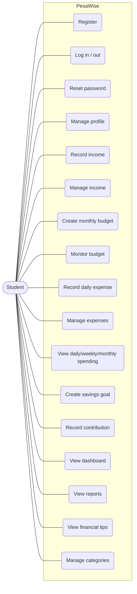
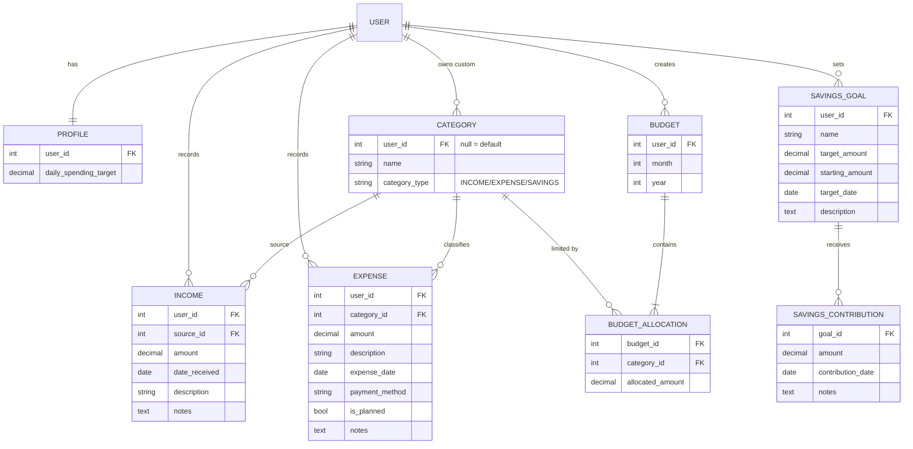

# PesaWise – Software Requirements Specification (SRS)

## 1. Introduction
**Purpose.** Specifies PesaWise, a web-based student personal finance and budgeting system (Python/Django, SQLite, Bootstrap 5, Chart.js).
**Problem.** Students receive money irregularly (parents, casual jobs) and struggle to track what they receive, spend and save.
**Objectives.** (1) record income from parents and other sources, (2) create monthly budgets, (3) record daily expenses, (4) categorize expenses,
(5) calculate balances automatically, (6) monitor budget use, (7) track savings goals, (8) show charts and reports, (9) give basic rule-based tips.

**In scope:** individual student accounts; manual entry of income, expenses, budgets and savings; KES only; responsive web UI; rule-based advisor.
**Out of scope / limitations:** Android, iOS, PWA; M-Pesa or bank integration; external AI/payment APIs; multi-currency; shared budgets; professional advice. PesaWise never stores PINs or bank credentials.

**Users.** Student (end user). Administrator (Django admin, maintenance only).

## 2. Functional requirements
| ID | Requirement |
|---|---|
| FR-A1–A5 | Register (name, email, username, password); log in/out; password reset; edit profile incl. daily spending target; all pages except auth require login |
| FR-I1–I6 | Record income (source, amount, date received, description, notes); edit; delete with confirmation; list; filter by source/date; total; compare sources; custom sources; only recorded income counts |
| FR-B1–B6 | One budget per month; category limits; total = sum of limits; actual vs limit, remaining, % used with progress bars; near-limit (≥80%) and over-limit (>100%) flags; copy previous budget |
| FR-E1–E11 | Quick-add expense from every page; fields: amount, description, category, date (default today), payment method, planned/unplanned, notes; multiple per day; edit; delete with confirmation; filters + search; daily/weekly/monthly totals; automatic balance; overspending allowed but flagged; daily summary (total, count, highest, by category, remaining daily target); custom categories; duplicate-submission protection |
| FR-S1–S4 | Savings goals (name, target, already saved, target date, description); contributions; history; progress %, remaining amount |
| FR-D1–D5 | Dashboard cards, five Chart.js charts, recent transactions with search/filter, seven reports, everything from the student's own records |
| FR-V1–V3 | Rule-based tips from real data; no tip without enough data; not-professional-advice disclaimer |

## 3. Non-functional requirements
Security (hashing, CSRF, per-user filtering, 404 on foreign records, env-based secrets) · Privacy (no credentials) · Accuracy (Decimal, 2 d.p., ROUND_HALF_UP) ·
Usability (an expense in ≤3 interactions from any page; plain language) · Performance (<2 s with ~5,000 records on SQLite) · Maintainability (calculations in `dashboard/services.py`) ·
Reliability (validation errors never crash; custom 403/404/500) · Compatibility (current Chrome, Firefox, Edge, Safari) · Localization (Africa/Nairobi, "KSh 1,234.50") · Testability (72 automated tests).

## 4. Use cases
UC1 Register · UC2 Log in/out · UC3 Reset password · UC4 Manage profile · UC5 Record income · UC6 Manage income records · UC7 Create monthly budget ·
UC8 Monitor budget · **UC9 Record daily expense** · UC10 Manage expenses · UC11 View daily/weekly/monthly spending · UC12 Create savings goal ·
UC13 Record savings contribution · UC14 View dashboard · UC15 View reports · UC16 View financial tips · UC17 Manage custom categories.

**UC9 Record daily expense.** *Pre:* logged in. *Main flow:* click **+ Expense** → form opens with today's date → enter amount, description, category (payment method, planned/unplanned) →
submit → system validates, saves, shows new balance and any budget warning → dashboard figures reflect the record.
*Alternates:* invalid/zero amount or future date → error shown; over budget → saved with warning; double-click → ignored as duplicate.

## 5. Use-case diagram

(Render at https://mermaid.live or in VS Code with a Mermaid extension.)

## 6. Entity Relationship Diagram


## 7. Database design (constraints)
`Category` unique (user, name, type) · `Budget` unique (user, month, year), month 1–12 · `BudgetAllocation` unique (budget, category), amount ≥ 0 ·
`Income`/`Expense`/`SavingsContribution` amount ≥ 0.01, date not in the future · `SavingsGoal` target ≥ 0.01, starting ≥ 0 ·
Income sources must be INCOME categories, expense categories EXPENSE; users may only use default or their own categories ·
Foreign keys to `Category` are PROTECT (a used category cannot be deleted). Budget total and goal current amount are **calculated**, not stored.

## 8. Financial calculation rules (`dashboard/services.py`)
| Quantity | Rule |
|---|---|
| Total income / expenses | Σ recorded amounts in the period |
| Savings transfers | Σ SavingsContribution.amount in the period |
| **Available balance** | Income − Expenses − Savings transfers |
| Goal current amount | starting_amount + Σ contributions (starting amount never changes the balance) |
| Remaining category budget | Allocated − Actual (may be negative) |
| Utilization % | Actual ÷ Allocated × 100; zero budget → 0% if nothing spent, otherwise "unbudgeted" (treated as over) |
| Status | ok < 80%, warning 80–100%, over > 100% |
| Savings progress % | min(100, current ÷ target × 100); Remaining = max(0, target − current) |
| Month budget remaining | Σ limits − (spending in budgeted categories + spending in unbudgeted categories + this month's contributions if a Savings line exists) |
| Week / month | Monday–Sunday / calendar month, Africa/Nairobi |

Savings are stored only as contributions, never as expenses, so they are subtracted once. Edits and deletes need no special handling because every figure is recomputed from records.

## 9. Architecture
```
Browser → urls.py → views.py → forms.py (validation) → services.py (Decimal maths) → models.py (ORM) → SQLite
```
Apps: `core` (Category, utilities), `accounts`, `income`, `budgets`, `expenses`, `savings`, `dashboard` (services, reports), `advisor` (rules).
Every query is filtered by `request.user`; detail/edit/delete views use `get_object_or_404(..., user=request.user)`.

## 10. Advisor rules
Budget missing · category ≥80% / >100% / on track after day 20 · spending without a budget line · today above the month's average (needs ≥5 earlier spending days) ·
daily target exceeded · ≥3 unplanned purchases in 7 days · per-goal savings progress / no contribution this month / past target date · negative balance.
A rule never fires without its minimum data. A disclaimer is shown.

## 11. Roadmap (completed)
Setup → accounts → categories → expenses → income → budgets → savings → services/dashboard/reports → advisor → tests, security check, documentation.
